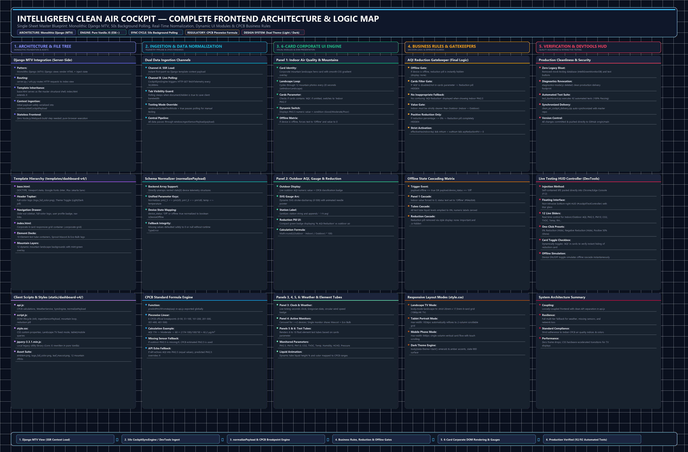
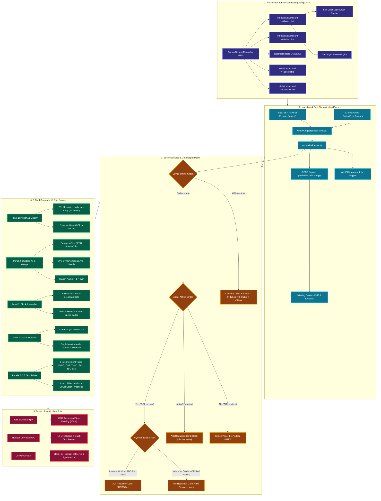

# IntelliGreen Clean Air Cockpit — Complete Frontend Architecture & System Logic Map

> [!IMPORTANT]
> **One-Sheet Master Blueprint**: Yeh single-sheet architecture map hamare Clean Air Cockpit frontend ke har ek component, data pipeline, business rule, aur user-interface module ko granular level par map karta hai.

---

## 🖼️ Architecture Blueprint Image (High-Resolution Single Sheet)

Neeche diya gaya blueprint **3800 × 2500 Ultra High-Definition (UHD)** resolution mein render kiya gaya hai. Isme system ka har ek feature aur technical rule documented hai:

*Direct Workspace File Link:* [clean_air_cockpit_architecture_map.png](file:///d:/Personal/clean_air_cockpit_backend_integration/clean_air_cockpit_architecture_map.png)

---

## 🌳 System Architecture Graph (Tree & Data Flow Hierarchy)

Neeche diye gaye hierarchical graph mein server rendering se lekar browser ke visual DOM updates tak ka complete data flow mapped hai:

---

## 📋 Comprehensive Domain Mapping Sheet

| Domain Section | Key Components / Features | Core Rules & Applied Logic |
| :--- | :--- | :--- |
| **1. Architecture & Files** | • `base.html`, `index.html` • `api.js`, `script.js`, `style.css` • Full Color Logo (`logo_full_color.png`) • 12 Mountain JPEGs + Mascot assets | • **Monolithic Django (MTV)**: No complex node build step; HTML served directly. • **Navigation Drawer**: Clean slide-out sidebar displaying company full-color logo. • **Dark/Light Theme**: CSS custom properties toggled via `data-theme` attribute. |
| **2. Data Ingestion** | • SSR Template Context • `CockpitSyncEngine` (50s loop) • `normalizePayload()` • `predictPm25FromAqi()` | • **Dual Ingestion**: Initial load via server-side context; background sync every 50 seconds. • **Bandwidth Saver**: Polling pauses when `document.hidden` is true. • **CPCB Interpolation**: Piecewise linear standard converts AQI to PM2.5 when sensor is missing or API duplicates AQI. |
| **3. Business Rules** | • Offline State Cascade • Cards Parameter Filter • AQI Reduction Gatekeeper | • **Offline Guard**: Forces indoor values to 0, status to "Offline", hides reduction pill. • **AQI Reduction Rule**: Strictly hides when Indoor AQI is disabled/omitted in `cards`, or when reduction $\le 0\%$ (non-negative filter). • **No Misleading Display**: Prevents displaying "AQI Reduction" when only showing Indoor PM2.5. |
| **4. 6-Card UI Grid** | • Panel 1: Indoor & Mountains • Panel 2: Outdoor & Gauge • Panel 3: Clock & Weather • Panel 4: Active Monitors • Panels 5 & 6: Test Tubes | • **Mountain Loop**: Cycles 12 mountain landscapes every 20s with mint-green overlay. • **SVG Gauge**: Real-time arc stroke and needle angle mapped to outdoor AQI. • **Single Monitor Mascot**: Shows Sprout mascot and Eco Bulb when exactly 1 monitor exists. • **Test Tubes**: Animated liquid gauges for PM10, CO2, TVOC, Temp, RH, HCHO, Pressure. |
| **5. Testing & Verification** | • `test_dashboard.py` (92 Tests) • Browser DevTools HUD Controller • Synchronized Delivery ZIP | • **Clean Production**: Zero mock DBs, deleted diagnostics modal, zero jQuery in core. • **Interactive Controller**: Floating panel with 12 sliders to simulate any live sensor state. • **Automated CI/CD**: 100% test pass rate pushed directly to GitHub `main` branch. |

---

### File Location:
- High-Resolution PNG Blueprint: [`clean_air_cockpit_architecture_map.png`](file:///d:/Personal/clean_air_cockpit_backend_integration/clean_air_cockpit_architecture_map.png)
- Delivery Archive: [`clean_air_cockpit_delivery.zip`](file:///d:/Personal/clean_air_cockpit_backend_integration/clean_air_cockpit_delivery.zip)
