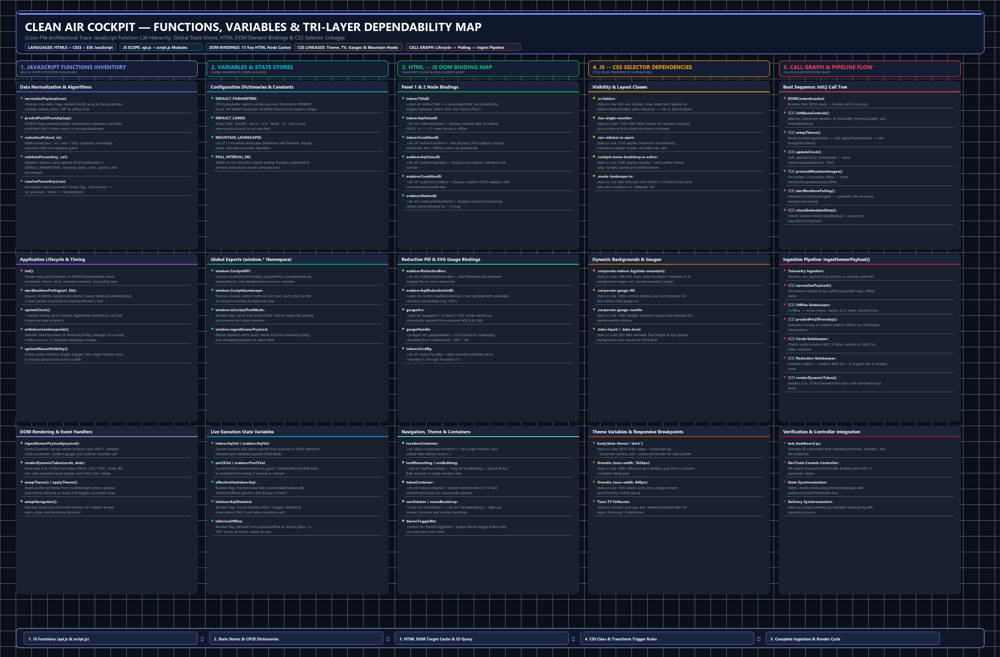

# Clean Air Cockpit — Functions, Variables & Tri-Layer Dependability Map

> [!IMPORTANT]
> **Tri-Layer Architectural Trace**: Yeh blueprint JavaScript functions, global state stores, HTML DOM element IDs, aur CSS style selector rules ke aapas ke exact rishte aur dependabilities ko exhaustively map karta hai.

---

## 🖼️ Functions & Dependability Blueprint Image (3800 × 2500 UHD)

Neeche diya gaya image blueprint **3800 × 2500 Ultra High-Definition (300 DPI)** resolution mein render kiya gaya hai. Isme frontend ke saare functions, variables, DOM nodes aur CSS triggers mapped hain:

*Direct Workspace File Link:* [clean_air_cockpit_functions_and_dependencies_map.png](file:///d:/Personal/clean_air_cockpit_backend_integration/clean_air_cockpit_functions_and_dependencies_map.png)

---

## 🌳 Tri-Layer Dependency Flow Graph (HTML ↔ CSS ↔ JS)

Neeche diye gaye hierarchical graph mein functions ki execution, DOM nodes ki binding aur CSS style triggers ki exact dependability mapped hai:

```mermaid
graph TD
    classDef jsFunc fill:#312e81,stroke:#818cf8,stroke-width:2px,color:#fff;
    classDef jsState fill:#0e7490,stroke:#06b6d4,stroke-width:2px,color:#fff;
    classDef htmlDOM fill:#065f46,stroke:#10b981,stroke-width:2px,color:#fff;
    classDef cssRule fill:#92400e,stroke:#f59e0b,stroke-width:2px,color:#fff;

    subgraph LayerJS["JavaScript Functions & Call Hierarchy"]
        Init["init()"]:::jsFunc --> Poll["startRealtimePolling(50s)"]:::jsFunc
        Init --> Clock["updateClock()"]:::jsFunc
        Init --> MountLoop["startLandscapeAutoLoop(20s)"]:::jsFunc
        Init --> Menu["setupNavigation()"]:::jsFunc
        Init --> Theme["setupTheme() / applyTheme()"]:::jsFunc

        Poll --> Ingest["ingestSensorPayload(payload)"]:::jsFunc
        Ingest --> Norm["normalizePayload()"]:::jsFunc
        Ingest --> CPCB["predictPm25FromAqi()"]:::jsFunc
        Ingest --> RedCalc["reductionPct()"]:::jsFunc
        Ingest --> Val["validateParam()"]:::jsFunc
        Ingest --> Tubes["renderDynamicTubes()"]:::jsFunc
        Ingest --> Mascot["updateMascotVisibility()"]:::jsFunc
    end

    subgraph LayerState["State Variables & Configuration Stores"]
        StateOffline["isDeviceOffline: boolean"]:::jsState
        StateAqi["indoorAqiVal / outdoorAqiVal"]:::jsState
        StatePm["pm25Val / outdoorPm25Val"]:::jsState
        StateCards["isIndoorAqiDisabled / effectiveHasIndoorAqi"]:::jsState
        StateParams["DEFAULT_PARAMETERS (CPCB Colors & Limits)"]:::jsState
        StateRed["aqiReductionPct: integer"]:::jsState
    end

    subgraph LayerHTML["HTML DOM Node Elements (base.html & index.html)"]
        NodeInTitle["<span id='indoorTitle'>"]:::htmlDOM
        NodeInVal["<div id='indoorAqiValue'>"]:::htmlDOM
        NodeInCond["<div id='indoorCondition'>"]:::htmlDOM
        NodeOutVal["<div id='outdoorAqiValue'>"]:::htmlDOM
        NodeOutCond["<div id='outdoorCondition'>"]:::htmlDOM
        NodeRedBox["<div id='outdoorReductionBox'>"]:::htmlDOM
        NodeRedVal["<span id='outdoorAqiReductionVal'>"]:::htmlDOM
        NodeGaugeArc["<path id='gaugeArc'>"]:::htmlDOM
        NodeGaugeNeedle["<polygon id='gaugeNeedle'>"]:::htmlDOM
        NodeMountBg["<div id='indoorCardBg'>"]:::htmlDOM
        NodeLoc["<div class='corporate-locations'>"]:::htmlDOM
        NodeTubes["<div id='tubesContainer'>"]:::htmlDOM
        NodeNav["<aside id='navSidebar'>"]:::htmlDOM
        NodeBackdrop["<div id='menuBackdrop'>"]:::htmlDOM
        NodeBody["<body data-theme='...'>"]:::htmlDOM
    end

    subgraph LayerCSS["CSS Selector & Transform Rules (style.css)"]
        RuleHidden["#outdoorReductionBox.is-hidden { display: none !important; }"]:::cssRule
        RuleMount["[data-mountain='mountain-X'] { background-image: url(...) }"]:::cssRule
        RuleSingle["corporate-locations.has-single-monitor { ... }"]:::cssRule
        RuleNav["nav-sidebar.is-open { transform: translateX(0); }"]:::cssRule
        RuleBackdrop["cockpit-menu-backdrop.is-active { opacity: 1; }"]:::cssRule
        RuleDark["body[data-theme='dark'] { --corporate-bg: #0b0f19; }"]:::cssRule
        RuleTV["body.mode-landscape-tv { grid-template-rows: 20rem 17.5rem; }"]:::cssRule
        RuleTube["tile-tube .tube-liquid { height: X%; background: ...; }"]:::cssRule
    end

    %% Function to State linkages
    Norm --> StateOffline
    Norm --> StateAqi
    Norm --> StatePm
    Ingest --> StateCards
    Ingest --> StateRed
    Val --> StateParams

    %% Function to HTML DOM linkages
    Ingest --> NodeInTitle
    Ingest --> NodeInVal
    Ingest --> NodeInCond
    Ingest --> NodeOutVal
    Ingest --> NodeOutCond
    Ingest --> NodeRedBox
    Ingest --> NodeRedVal
    Ingest --> NodeGaugeArc
    Ingest --> NodeGaugeNeedle
    MountLoop --> NodeMountBg
    Mascot --> NodeLoc
    Tubes --> NodeTubes
    Menu --> NodeNav
    Menu --> NodeBackdrop
    Theme --> NodeBody

    %% HTML DOM to CSS Rule linkages
    NodeRedBox --> RuleHidden
    NodeMountBg --> RuleMount
    NodeLoc --> RuleSingle
    NodeNav --> RuleNav
    NodeBackdrop --> RuleBackdrop
    NodeBody --> RuleDark
    NodeBody --> RuleTV
    NodeTubes --> RuleTube
```

---

## 📋 Comprehensive Cross-File Dependency Matrix

### 1. JavaScript Function Inventory (`api.js` & `script.js`)
| Function Name | Location | Primary Responsibilities | Caller Functions | Callee Functions |
| :--- | :--- | :--- | :--- | :--- |
| `init()` | `script.js` | Application bootstrapper on DOM ready | `DOMContentLoaded` | `initMenuControls`, `setupTheme`, `updateClock`, `preloadMountainImages`, `startRealtimePolling`, `checkEmbeddedData` |
| `startRealtimePolling(url, 50s)` | `script.js` | 50s cyclic timer with visibility guard | `init()` | `fetchTelemetry()`, `normalizePayload()`, `ingestSensorPayload()` |
| `normalizePayload(raw)` | `api.js` & `script.js` | Unwraps `stats[0]`, unifies property keys, parses offline state | `startRealtimePolling`, `ingestSensorPayload` | `pickFloat()`, `resolveParamKey()` |
| `predictPm25FromAqi(aqi)` | `api.js` & `script.js` | CPCB 6-stage piecewise linear formula for missing outdoor PM2.5 | `ingestSensorPayload()` | *Math calculations* |
| `reductionPct(out, in)` | `api.js` & `script.js` | Computes reduction % with non-negative guard | `ingestSensorPayload()` | *Math calculations* |
| `validateParam(key, val)` | `api.js` & `script.js` | Matches value to CPCB thresholds in `DEFAULT_PARAMETERS` | `ingestSensorPayload()`, `renderDynamicTubes()` | *Parameter dictionary lookups* |
| `setIndoorLandscape(idx)` | `script.js` | Cycles 12 mountain photos on `#indoorCardBg` | `startLandscapeAutoLoop()`, `nextIndoorLandscape()` | `resolveAssetUrl()` |
| `updateMascotVisibility()` | `script.js` | Toggles `.has-single-monitor` for Sprout mascot & Eco Bulb | `ingestSensorPayload()`, `initDeviceList()` | *ClassList toggle* |
| `renderDynamicTubes(cards, data)`| `script.js` | Dynamically renders 6 to 10 fluid element test tubes | `ingestSensorPayload()` | `validateParam()`, `getVal()` |
| `applyTheme(theme, save)` | `script.js` | Toggles `data-theme` on `body` (Light vs Dark) | `setupTheme()`, `toggleTheme()` | *DOM attribute setters* |

---

### 2. State & Variable Dependency Matrix
| Variable / Constant | Scope | Data Type | Consumer Functions | Purpose / Impact |
| :--- | :--- | :--- | :--- | :--- |
| `DEFAULT_PARAMETERS` | Global/File | `Object` | `validateParam`, `renderDynamicTubes` | Stores CPCB ranges and color codes for 12+ environmental gases. |
| `DEFAULT_CARDS` | Global/File | `Array<string>` | `getActiveCards`, `renderDynamicTubes` | Fallback cards list `['AQI', 'pm2d5', 'pm10', 'co2', 'temp', 'rh', 'tvoc']`. |
| `window.isCockpitTestMode` | `window` | `boolean` | `startRealtimePolling`, DevTools HUD | When `true`, freezes 50s polling so manual testing values are preserved. |
| `window.CockpitAPI` | `window` | `Object` | External scripts, testing harness | Exposes `predictPm25FromAqi`, `reductionPct`, and `WeatherService`. |
| `isDeviceOffline` | Execution State | `boolean` | `ingestSensorPayload` | Derived from `offline: true` or `device_status: 'Off'`; cascades zeroes to indoor cards. |
| `isIndoorAqiDisabled` | Execution State | `boolean` | `ingestSensorPayload` | `true` when `"AQI"` is not present in `cards`; triggers PM2.5 fallback & hides reduction pill. |
| `effectiveHasIndoorAqi` | Execution State | `boolean` | `ingestSensorPayload` | `hasIndoorAqi && !isIndoorAqiDisabled && !isDeviceOffline`; governs Panel 1 AQI rendering. |
| `aqiReductionPct` | Execution State | `number` | `ingestSensorPayload` | Integer reduction %; if $\le 0\%$, card is forced hidden. |

---

### 3. HTML DOM Target Binding & CSS Selector Linkages
| HTML Element ID / Class | JS DOM Variable | Linked CSS Selector / Property | Functional Behavior in App |
| :--- | :--- | :--- | :--- |
| `` | `indoorTitleEl` | `font-size`, `font-weight` | Dynamically displays `"Indoor AQI"` or `"Indoor PM2.5"`. |
| `
` | `indoorAqiValueEl` | `font-size: 4.5rem;` | Displays numeric AQI value or formatted PM2.5 (or `"Offline"` / `"0"`). |
| `
` | `indoorConditionEl` | `color: var(...)` | Displays CPCB status caption with dynamic color matching. |
| `
`| `outdoorReductionBox`| `#outdoorReductionBox.is-hidden { display: none !important; }` | **AQI Reduction Card**: Visible only when `effectiveHasIndoorAqi && inNum < outNum && aqiReductionPct > 0`. |
| ``| `outdoorAqiReductionValEl` | `font-weight: 700;` | Displays reduction percentage text (e.g., `"45%"`). |
| `<path id="gaugeArc">` | `gaugeArc` | `.corporate-gauge-fill { stroke-dasharray: ... }` | SVG stroke dynamic fill mapped to outdoor AQI (0 to 500). |
| `<polygon id="gaugeNeedle">`| `gaugeNeedle` | `.corporate-gauge-needle { transform: rotate(...) }` | Needle angle dynamically rotated from $0^\circ$ to $180^\circ$. |
| `
` | `indoorCardBg` | `.corporate-indoor-bg[data-mountain="mountain-X"]` | Dynamic 20s rotation of 12 mountain landscape images with mint-green overlay. |
| `
`| `locationContainer`| `.corporate-locations.has-single-monitor` | Automatically expands Sprout Mascot & Eco Bulb when monitor count is 1. |
| `
` | `tubesContainer` | `.tile-tube .tube-liquid { height: X%; background: ...; }` | Parent container holding 6 to 10 fluid element test tubes. |
| `<aside id="navSidebar">` | `navSidebar` | `.nav-sidebar.is-open { transform: translateX(0); }` | Slide-out navigation drawer displaying the company full-color logo. |
| `<body data-theme="...">` | `document.body` | `body[data-theme="dark"] { --corporate-bg: #0b0f19; }` | Toggles between Light and Dark high-contrast executive visual themes. |

---

### File Location:
- High-Resolution PNG Blueprint: [`clean_air_cockpit_functions_and_dependencies_map.png`](file:///d:/Personal/clean_air_cockpit_backend_integration/clean_air_cockpit_functions_and_dependencies_map.png)
- System Architecture Blueprint: [`clean_air_cockpit_frontend_architecture_blueprint.md`](file:///C:/Users/Hp/.gemini/antigravity/brain/1c987cb4-847f-4850-8cc1-f075f097a2e8/clean_air_cockpit_frontend_architecture_blueprint.md)
